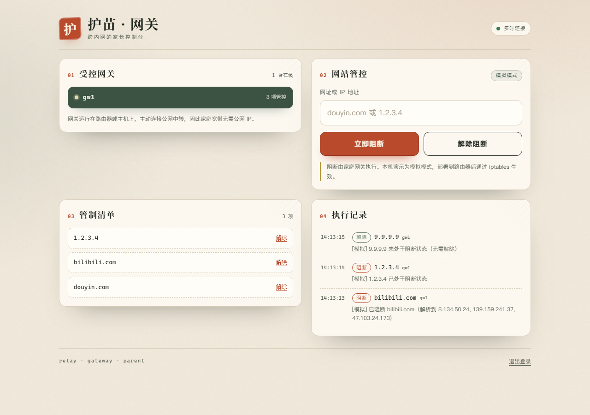
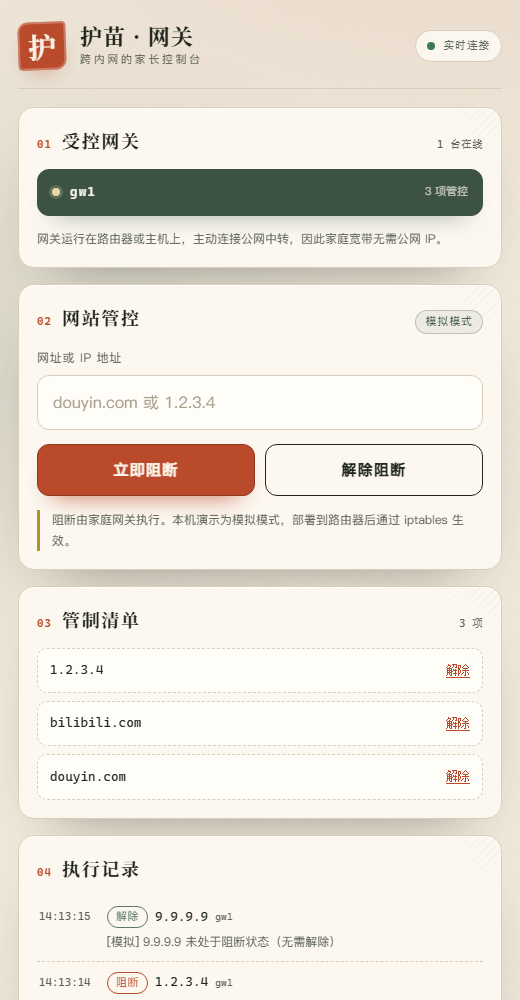
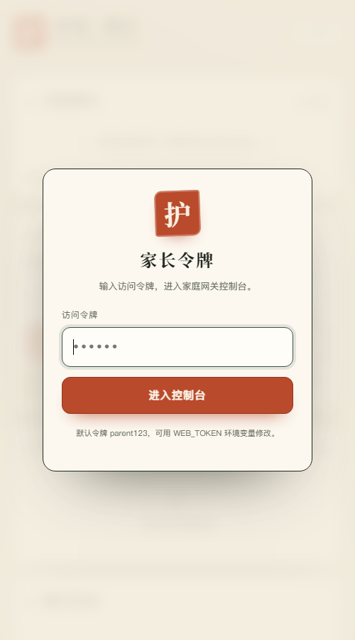

# 护苗 · 家庭网关远程管控

> 计算机网络项目作业二 · 用 AI 辅助完成
>
> 三端架构：家庭网关（路由器/主机）+ 公网中转 + 手机网页控制台，演示家长如何**跨越内网**远程管控家里的上网设备。



| 手机控制台                                | 令牌登录                             |
| ----------------------------------------- | ------------------------------------ |
|  |  |

## 项目功能

- **跨内网控制**：网关主动向公网中转建立长连接，家庭宽带不需要公网 IP，也不用在路由器上做端口映射。
- **手机网页控制台**：家长用手机浏览器即可选择网关、阻断/解除网站，无需安装 App。
- **IP 与域名管控**：输入 `1.2.3.4` 或 `douyin.com`，网关把域名解析成 A/AAAA 记录后逐条应用规则。
- **实时同步**：SSE 推送网关上下线、管制清单、执行结果；多家长端并发操作时，回执按请求号精确返回发起者。
- **幂等规则**：重复阻断/解除返回正确状态；域名解析出的多个 IP 统一管理。
- **双运行模式**：Windows/本机默认模拟模式；Linux 路由器或主机设置 `USE_REAL_IPTABLES=1` 后用 iptables 真正生效。
- **命令行家长端**：`parent.py` 提供与网页等价的控制能力，便于演示协议。
- **安全基线**：网页令牌登录、角色校验、IP/域名校验、单行消息上限、静态文件目录穿越防护。

## 系统架构

```text
        手机 / 电脑浏览器                         ┌───────────────┐
   HTTP + SSE (8080) ──────────────────────────▶ │   relay.py    │
                                                 │  中转服务器    │
        parent.py 命令行 ── TCP/JSON (9000) ───▶ │  公网 VPS     │
                                                 └───────┬───────┘
                                                         │ TCP/JSON (9000)
                                                         │ 网关主动反向连接
                                                 ┌───────▼───────┐
                                                 │  gateway.py   │
                                                 │ 路由器 / 主机  │
                                                 └───────┬───────┘
                                                         │ iptables（真实模式）
                                                     家庭局域网
```

- `relay.py`：公网中转，维护在线网关、转发指令、路由回执，并托管网页控制台。
- `gateway.py`：部署在路由器或主机上，执行管控规则并上报状态。
- `parent.py`：命令行家长端，通过同一套 TCP 协议控制网关。
- `web/`：手机网页控制台，静态页面 + SSE 实时通道。

## 文件说明

| 文件                                | 作用                                                     |
| ----------------------------------- | -------------------------------------------------------- |
| `common.py`                         | 三端共用配置、JSON 行收发、IP/域名校验、局域网地址枚举   |
| `hub.py`                            | 中转共享状态：在线设备、待回执请求、历史记录、广播与路由 |
| `relay.py`                          | 中转 TCP 服务 + 启动网页控制台                           |
| `webconsole.py`                     | 纯 asyncio HTTP/SSE 服务、令牌认证、静态文件托管         |
| `web/index.html`                    | 手机优先的控制台页面                                     |
| `web/style.css`                     | 「家书 · 守护」暖纸/墨绿/朱砂视觉样式                    |
| `web/app.js`                        | 登录、状态渲染、指令下发、SSE 实时更新                   |
| `gateway.py`                        | 家庭网关：心跳、域名解析、模拟 / 真实 iptables 规则      |
| `parent.py`                         | 命令行家长端                                             |
| `demo_online.py`                    | 单进程演示入口：中转 + 模拟网关 + 网页控制台             |
| `Dockerfile` / `docker-compose.yml` | 一条命令容器化运行                                       |
| `test_e2e.py`                       | 端到端测试（自动拉起中转、网关、网页客户端）             |
| `run_demo.bat`                      | Windows 一键启动三个窗口的演示                           |
| `.github/workflows/tests.yml`       | 推送到 GitHub 后自动运行端到端测试                       |
| `deploy/`                           | VPS、树莓派/OpenWrt 部署文档与 systemd 单元              |
| `docs/`                             | 界面截图                                                 |
| `gateway_actions.log`               | 网关操作日志（请求号、动作、结果）                       |

## 快速开始

需要 Python 3.8+，**无第三方依赖**。

### 方式一：Windows 一键演示

双击 `run_demo.bat`，会自动打开中转、网关、命令行家长端三个窗口，并打开浏览器控制台。

浏览器访问 <http://127.0.0.1:8080>，默认令牌：**parent123**。

### 方式二：手动启动

```bash
python relay.py      # 终端 1：中转 + 网页控制台（9000 / 8080）
python gateway.py    # 终端 2：模拟家庭网关
python parent.py     # 终端 3：可选，命令行家长端
```

中转启动时会打印手机访问地址，例如：

```text
[WEB] 手机访问: http://192.168.1.23:8080
```

手机与电脑连同一 Wi-Fi，用浏览器打开该地址即可。若中转部署在公网 VPS，手机在任何网络下访问 `http://VPS_IP:8080`（见 `deploy/README.md`）。

### 方式三：单进程运行（看效果最快）

```bash
python demo_online.py
```

中转、模拟网关、网页控制台在同一个进程里启动，浏览器打开 <http://127.0.0.1:8080>，令牌 `parent123`。适合快速演示。

### 方式四：Docker

```bash
docker compose up --build
```

然后访问 <http://127.0.0.1:8080>。

### 真实网关

在 Linux 路由器或主机上，以 root 运行：

```bash
sudo USE_REAL_IPTABLES=1 RELAY_HOST=你的VPS地址 python3 gateway.py
```

规则只阻断到目标 IP 的出站流量；恢复时按目标删除对应规则。

## 使用说明

### 手机网页控制台

1. 输入访问令牌登录（默认 `parent123`，可用 `WEB_TOKEN` 修改）。
2. 在「受控网关」里选择要管控的设备，例如 `gw1`。
3. 输入网址或 IP，点「立即阻断」；或在「管制清单」里点「解除」。
4. 「执行记录」会实时显示每次操作的结果，SSE 保证页面无需刷新。

### 命令行家长端

```text
list / status      查看在线网关
use <设备号>       选择要控制的网关（默认 gw1）
block <IP|域名>    阻断
unblock <IP|域名>  解除
help               帮助
quit               退出
```

示例：

```text
> use gw1
> block douyin.com
[PARENT] 已发送 block douyin.com -> gw1（req 3f2a9c1d）
[回执 3f2a9c1d] block douyin.com @ gw1: 成功 - [模拟] 已阻断 douyin.com（解析到 ...）
```

## 如何跨越内网（原理说明）

家用宽带通常位于 NAT 后面：路由器持有公网地址，内网设备只有私有地址（如 `192.168.x.x`），**公网无法主动连接内网设备**，运营商还可能使用 CGNAT，导致即使做了端口映射也不一定可用。

本项目的做法与 UU 远程、向日葵等远程工具的思路一致，属于**反向连接 + 中转转发**：

1. `gateway.py` 启动后主动向公网 `relay.py` 发起 TCP 连接，并定时发送心跳，保持这条长连接。
2. NAT 允许「内网主动发起」的连接，因此这条由内向外的连接可以稳定存在；家庭路由器不需要任何入站端口映射。
3. 家长端（手机浏览器或 `parent.py`）同样连接中转服务器。
4. 中转按 `device_id` 找到对应网关的已有连接，把指令从这条反向连接原路推下去；网关执行后把回执发回中转，中转再按 `req_id` 路由给发起命令的家长端。

对比其他方案：

| 方案           | 原理                                     | 前提                                       | 本项目         |
| -------------- | ---------------------------------------- | ------------------------------------------ | -------------- |
| 端口映射       | 在路由器上把公网端口转发到内网主机       | 必须有公网 IP，运营商允许入站              | 不需要         |
| UDP 打洞 / P2P | 双方同时向对方公网映射地址发包，尝试直连 | 双方 NAT 类型友好，对称 NAT / CGNAT 常失败 | 可作为后续优化 |
| 中转反向连接   | 双方都连公网中转，由中转转发             | 一台有公网 IP 的中转服务器                 | **已实现**     |

因此，真正部署时唯一需要公网可达的是 `relay.py`（VPS），网关和家长端都可以在内网。演练时三端都在本机，效果等价。

## 通信协议

### TCP 控制通道（JSON 行，端口 9000）

| type         | 方向                 | 关键字段                                                                    | 说明                       |
| ------------ | -------------------- | --------------------------------------------------------------------------- | -------------------------- |
| `register`   | 网关 → 中转          | `device_id`                                                                 | 网关注册                   |
| `registered` | 中转 → 网关          | `device_id`                                                                 | 注册确认                   |
| `parent`     | 家长端 → 中转        | —                                                                           | 家长端接入                 |
| `heartbeat`  | 网关 → 中转          | `device_id`                                                                 | 心跳，默认 10s 一次        |
| `cmd`        | 家长端 → 中转 → 网关 | `req_id`、`device_id`、`payload.action`、`payload.target`                   | 下发管控指令               |
| `result`     | 网关 → 中转 → 家长端 | `req_id`、`device_id`、`payload.ok`、`payload.msg`、`payload.action/target` | 执行回执                   |
| `state`      | 网关 → 中转 → 家长端 | `payload.blocked`、`payload.mode`                                           | 网关当前管控清单与运行模式 |
| `list`       | 家长端 → 中转        | —                                                                           | 查询在线网关               |
| `status`     | 中转 → 家长端        | `gateways`、`devices`、`history`                                            | 在线设备与记录             |
| `event`      | 中转 → 家长端        | `event`、`device_id`、`reason`                                              | 网关上线/下线推送          |

### 网页 HTTP / SSE（端口 8080）

| 方法与路径                                | 说明                                                               |
| ----------------------------------------- | ------------------------------------------------------------------ |
| `GET /`                                   | 控制台页面（公开，登录逻辑在前端）                                 |
| `GET /api/status`                         | 在线设备、管控清单、历史记录（需令牌）                             |
| `GET /api/history`                        | 执行记录（需令牌）                                                 |
| `POST /api/command`                       | 下发指令，body：`{device_id, action, target, client_id}`（需令牌） |
| `GET /api/events?token=...&client_id=...` | SSE 实时通道，推送 `hello/status/state/event/result`               |

令牌通过 `X-Auth-Token` 请求头传递；SSE 由于浏览器的 `EventSource` 不能自定义请求头，改用查询参数。

## 配置项（环境变量）

| 变量                 | 默认值      | 说明                                                  |
| -------------------- | ----------- | ----------------------------------------------------- |
| `RELAY_HOST`         | `127.0.0.1` | 网关/家长端连接的中转地址（部署到 VPS 时改成公网 IP） |
| `RELAY_BIND`         | `0.0.0.0`   | 中转 TCP 监听地址                                     |
| `RELAY_PORT`         | `9000`      | 中转 TCP 端口                                         |
| `DEVICE_ID`          | `gw1`       | 网关设备号                                            |
| `TARGET_DEVICE`      | `gw1`       | 命令行家长端默认目标                                  |
| `USE_REAL_IPTABLES`  | `0`         | 设为 `1` 且 root 运行时执行真实 iptables              |
| `HEARTBEAT_INTERVAL` | `10`        | 网关心跳间隔（秒）                                    |
| `HEARTBEAT_TIMEOUT`  | `30`        | 中转判定网关掉线的超时（秒）                          |
| `CMD_TIMEOUT`        | `15`        | 家长端等待回执的超时（秒）                            |
| `WEB_BIND`           | `0.0.0.0`   | 网页控制台监听地址                                    |
| `WEB_PORT`           | `8080`      | 网页控制台端口                                        |
| `WEB_TOKEN`          | `parent123` | 网页访问令牌（**正式部署务必修改**）                  |

## 测试

```bash
python test_e2e.py
```

自动验证 23 项：网关注册上线、阻断/解除、重复操作幂等、非法目标拒绝、离线网关报错、未授权连接拒绝、网页令牌 401、静态页与状态接口、SSE 欢迎消息、网页下发指令与实时回执、管制清单同步、执行记录查询、网页非法参数拒绝、心跳超时清理、上下线事件、在线列表更新。

仓库已配置 GitHub Actions（`.github/workflows/tests.yml`），每次推送或提交 PR 都会在 Ubuntu + Python 3.12 上自动运行这套测试。

推送后 Actions 会自动跑一遍端到端测试，仓库页面的 Actions 标签可以看到结果。

## 设计要点

1. **共享状态层 `hub.py`**：TCP 家长端与网页控制台使用同一份在线表、待回执请求和历史记录，避免两套逻辑状态不一致。
2. **请求号路由**：每条指令生成唯一 `req_id`；回执只发给发起者，多个家长/浏览器并发操作不会串台（发起者掉线则丢弃，不广播）。
3. **心跳与清理**：网关定时心跳；中转超时后主动关闭 TCP 连接、推送下线事件，避免连接泄漏。网关重连采用指数退避，稳定运行 30s 后复位。
4. **SSE 实时推送**：网页通过单条长连接接收状态变化，断线由浏览器自动重连；服务器每 20s 发注释心跳。
5. **规则幂等与域名**：模拟模式用集合记录状态；真实模式用 `iptables -C` 检查后再增删。域名解析出多个 IP 时全部登记，解除时跳过仍被其他规则引用的 IP。
6. **防御性校验**：三端都校验动作与 IP/域名；中转只接受家长端指令、只接受已注册网关的 `state/result`；消息单行上限 64KB；静态文件只允许 `web/` 下的单层文件名，防止目录穿越。
7. **可观测性**：网关日志记录请求号、动作、结果；中转和控制台保留最近 100 条执行记录。

## 部署

见 [deploy/README.md](deploy/README.md)，包含：

- 公网 VPS 部署中转（systemd + 防火墙）
- 树莓派 / Linux 主机部署网关（真实 iptables）
- OpenWrt 路由器部署注意事项
- 手机在外网访问控制台（含 HTTPS 反代示例）
- 部署安全清单

## 已知限制与可扩展方向

- 通信为明文 TCP / HTTP，令牌只是课程演示级认证；公网部署应加 TLS（Caddy/Nginx 反代）并修改默认令牌。
- 单台中转是单点，未做集群、消息持久化和限流；执行记录只保存在内存。
- 域名阻断基于网关侧 DNS 解析结果，CDN 域名可能解析到多个或变化的 IP；按域名拦截（如 dnsmasq）更适合路由器生产环境。
- 真实模式只阻断到目标 IP 的出站流量，且需要 Linux + root；Windows 默认走模拟模式。
- 未实现定时管控、按 MAC 的设备级管控、应用识别等扩展功能，可作为后续方向。
